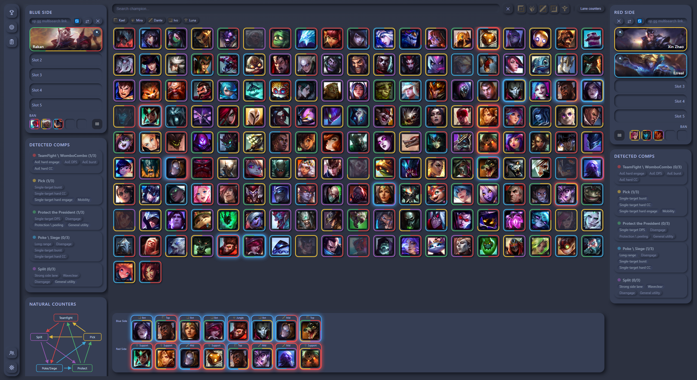
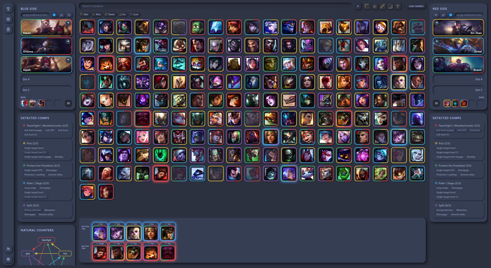
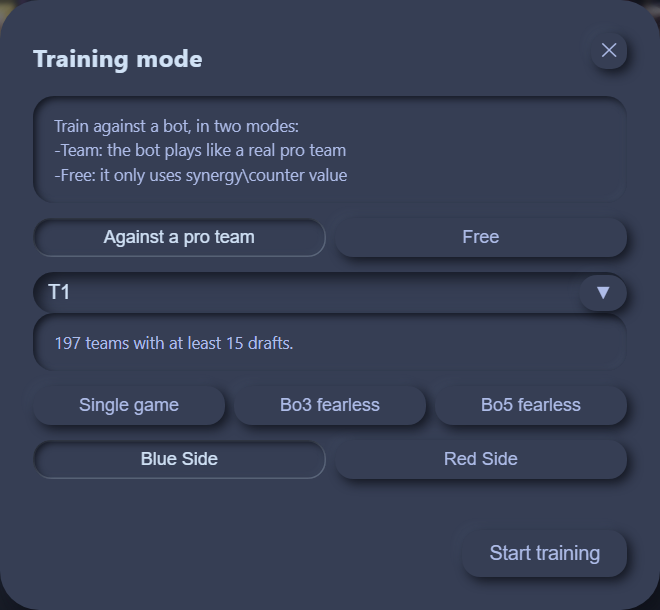
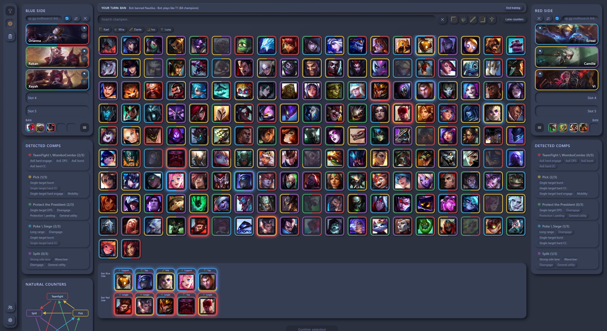
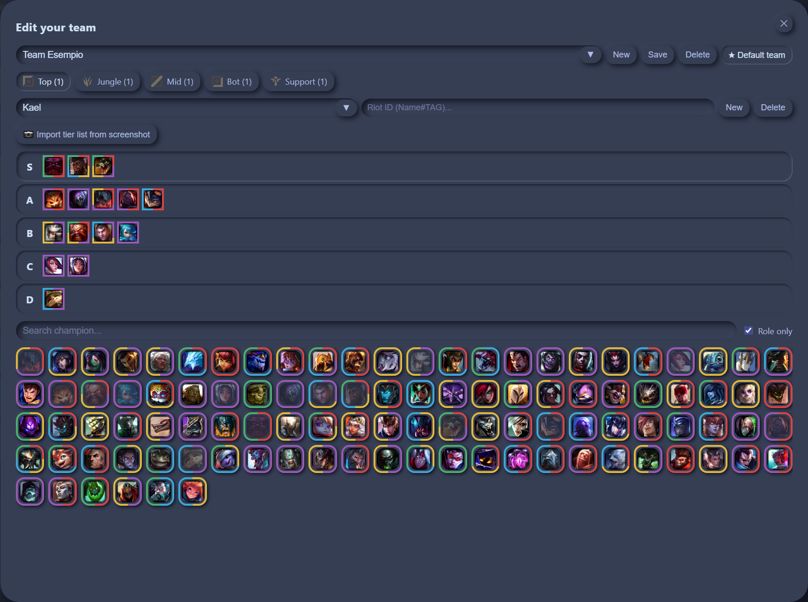
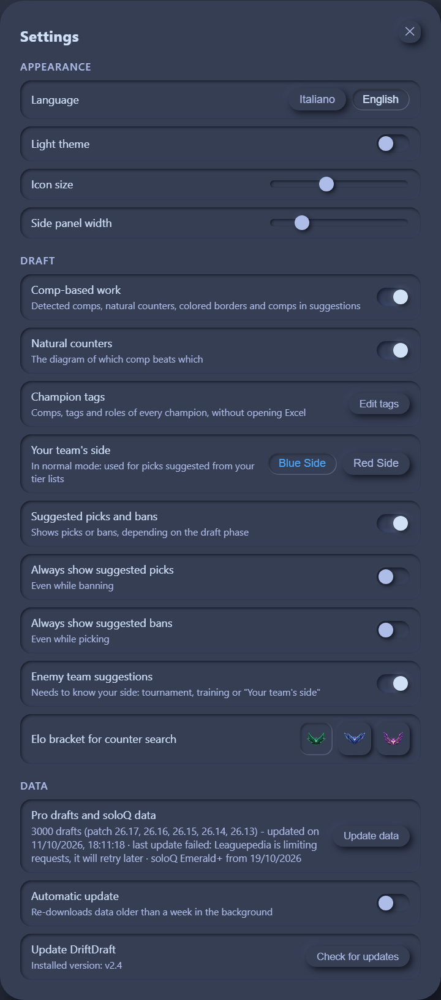

# DriftDraft

*[Italiano](README.md) · English*

A coaching tool for *League of Legends* drafts. It tells you which team
compositions are taking shape while you draft and which picks suit each side,
both as preparation and live on drafter.lol, and it trains you against a bot
that plays like a real team.

It runs entirely locally on your computer: **no data leaves your PC**, except
the requests you make to op.gg, lolalytics, u.gg, Leaguepedia and drafter.lol
(and to GitHub, when you check for a new version).

The interface is available in English, Italian, French, German, Spanish and
Chinese (Settings → Language).

## What DriftDraft can do for you

**It sees the comps while you build them.** Every champion carries functional
tags and comp memberships; the side panels show at a glance what is forming on
each side, and which pieces are still missing. The natural counters pentagon
shows which comp beats which.

**It suggests picks and bans, per side.** The score comes from synergies and
counters observed in 3000 recent professional drafts; where pro play falls
short (Briar, Evelynn and the other champions you never see in competitive),
lolalytics soloQ data steps in. During bans you see the suggested bans, during
picks the picks: it follows the draft phase.

**Counters in one click.** From a slot's magnifying glass you instantly find
who beats that champion in its lane, in the elo bracket you prefer.

**Training against real picks.** The bot impersonates a real pro team, chosen
by you or at random among 197, picking from what that team actually plays. It
thinks in comps: it understands what you are trying to do and tries to get
ahead of you.

**Know your team.** In the roster you keep your players with their personal
tier lists — S for one-tricks, down to D for the ones to avoid — and the
suggestions for your side come from there; alternatively, an op.gg of your
team on the right side is enough. Pick a default team and DriftDraft loads it
by itself at every startup. With an op.gg link you can also get the enemy
team's data automatically, with suggested picks updated accordingly.

**It connects to a real draft.** In tournament mode it mirrors a
[drafter.lol](https://drafter.lol) draft room live and sends your selections
as actions on the draft, with fearless draft support.

# A few examples:

## Installation

Download the installer from the latest
[release](https://github.com/T57HeavyTank/DriftDraft/releases) and run it:
everything is included, it works right away.

On first launch it downloads the champion images (~21 MB, under a minute): it
needs a connection, and it only happens once.

Since 2.4 it updates from inside the app: Settings → Update DriftDraft. Your
teams and saved drafts are kept.

To work on the code rather than use it, see
[CONTRIBUTING.md](CONTRIBUTING.md) (in Italian).

## License

DriftDraft is free software under the **GNU General Public License v3.0 or
later** — see [LICENSE](LICENSE).

You can use, study, modify and redistribute it. If you redistribute it,
modified or not, you must do so under the same license and make the source
available: nobody can take it, close it and pass it off as their own.

This program is distributed in the hope that it will be useful, but **WITHOUT
ANY WARRANTY**; without even the implied warranty of MERCHANTABILITY or
FITNESS FOR A PARTICULAR PURPOSE. See the GNU General Public License for more
details.

## Credits and data sources

What belongs to others and where it comes from — libraries, uBlock Origin Lite
shipped with the package, champion images, pro draft data — is in
[THIRD-PARTY.md](THIRD-PARTY.md) (in Italian), together with Riot Games' legal
notice.

The champion tags and the five comps are the author's original work,
compiled by hand.

DriftDraft was created under Riot Games' "Legal Jibber Jabber" policy using
assets owned by Riot Games. Riot Games does not endorse or sponsor this
project.
